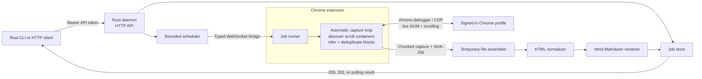
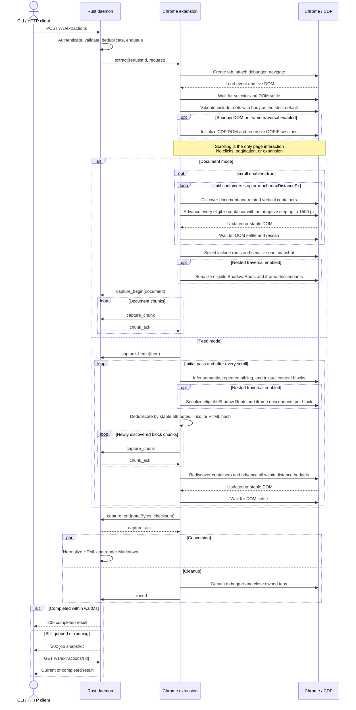
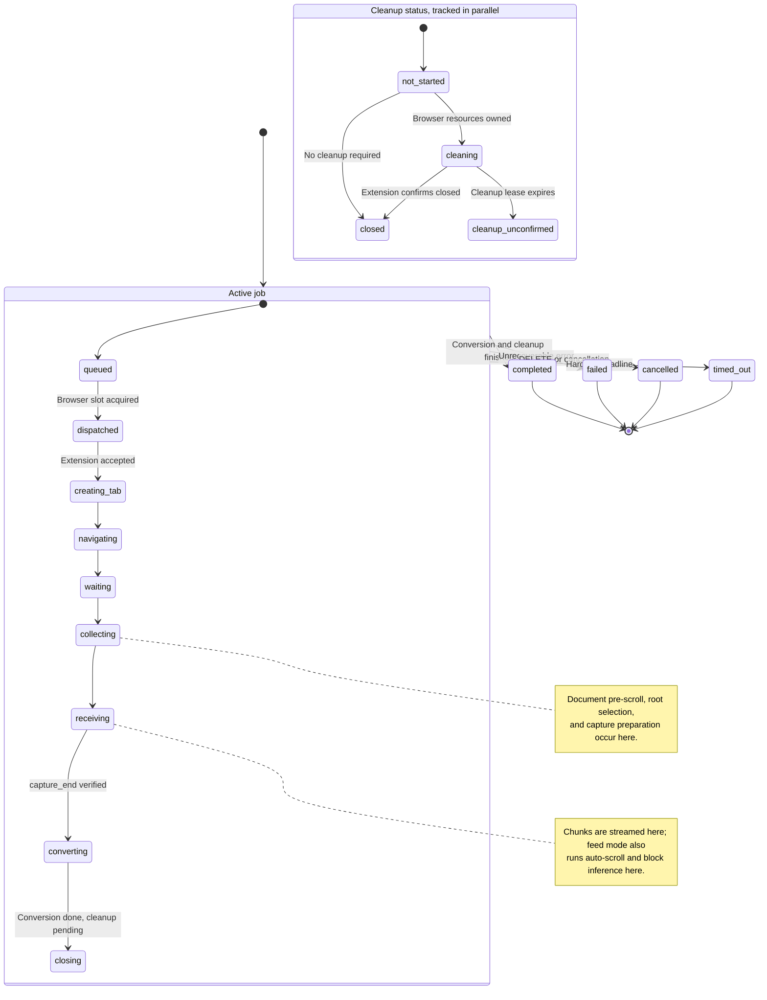
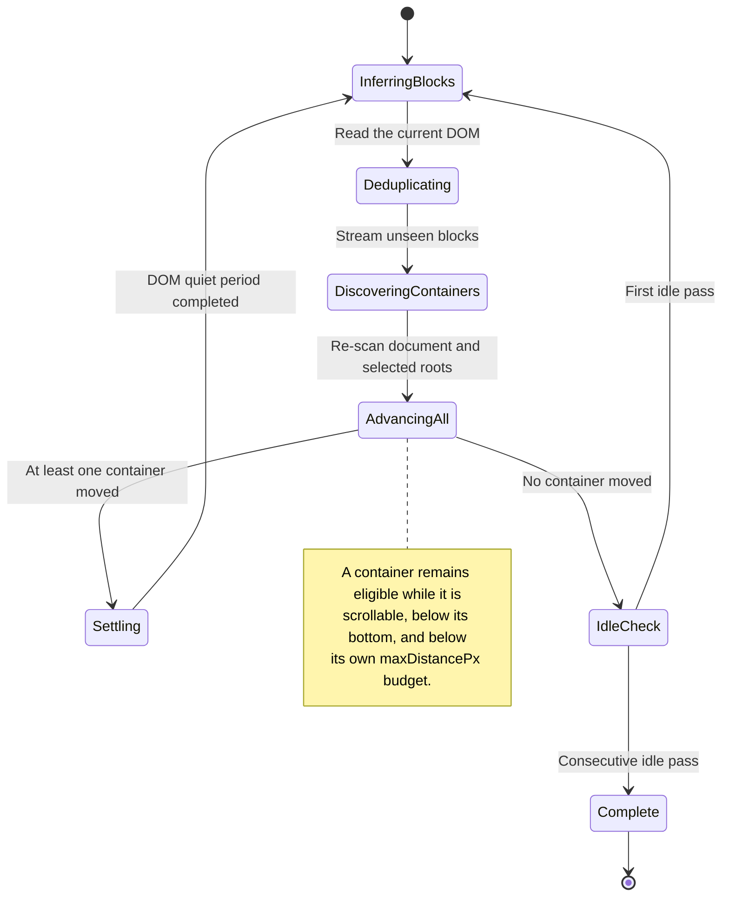
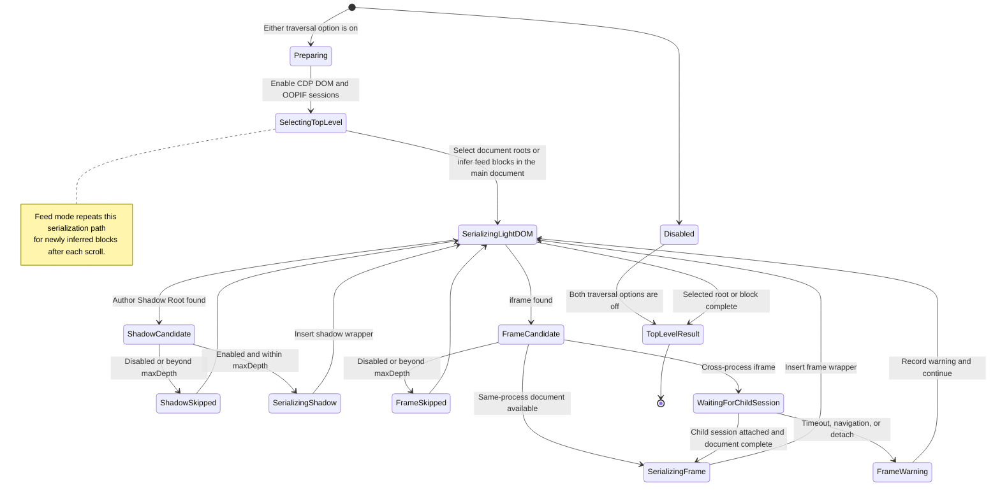

English | [简体中文](README_ZH.md)

# Browser Extractor

## Features

- **Real-browser extraction**
  - Uses a signed-in Chrome or Chromium browser, a CDP-powered extension, and a Rust daemon without Playwright or another browser automation runtime.
  - Cookies, credentials, and login state remain in the browser on the deployment host.
- **Local or remote deployment**
  - Run it as a local service or expose its API through a properly secured reverse proxy.
- **Live-DOM controls**
  - Supports top-level element selection and exclusion, scrolling, Shadow Root traversal, and same-origin or cross-origin iframe traversal.
- **Three-step setup**
  - Load and configure the extension, configure and start the daemon, then call the HTTP API.
  - An optional CLI client is included for command-line use.
- **Compact Rust programs**
  - The daemon and CLI executables are each under 10 MB.
  - The CLI writes Markdown with YAML Front Matter by default; run `scrape --help` for details.

## Downloads

Every archive has a matching SHA-256 sidecar. The release also publishes an aggregate [SHA256SUMS](https://github.com/Joey-Kot/Browser-Extractor/releases/download/Latest/SHA256SUMS) file.

### Browser extension

| Component | Download | SHA-256 |
|---|---|---|
| Chrome/Chromium extension | [Browser Extractor](https://github.com/Joey-Kot/Browser-Extractor/releases/download/Latest/browser-extractor-extension.zip) | [sha256](https://github.com/Joey-Kot/Browser-Extractor/releases/download/Latest/browser-extractor-extension.zip.sha256) |

### Server binaries

| Platform | Download | SHA-256 |
|---|---|---|
| Linux x86_64 | [linux-x86_64](https://github.com/Joey-Kot/Browser-Extractor/releases/download/Latest/browser-extractor-server-linux-x86_64.tar.gz) | [sha256](https://github.com/Joey-Kot/Browser-Extractor/releases/download/Latest/browser-extractor-server-linux-x86_64.tar.gz.sha256) |
| Linux arm64 | [linux-arm64](https://github.com/Joey-Kot/Browser-Extractor/releases/download/Latest/browser-extractor-server-linux-arm64.tar.gz) | [sha256](https://github.com/Joey-Kot/Browser-Extractor/releases/download/Latest/browser-extractor-server-linux-arm64.tar.gz.sha256) |
| Windows x86_64 | [windows-x86_64](https://github.com/Joey-Kot/Browser-Extractor/releases/download/Latest/browser-extractor-server-windows-x86_64.zip) | [sha256](https://github.com/Joey-Kot/Browser-Extractor/releases/download/Latest/browser-extractor-server-windows-x86_64.zip.sha256) |
| Windows arm64 | [windows-arm64](https://github.com/Joey-Kot/Browser-Extractor/releases/download/Latest/browser-extractor-server-windows-arm64.zip) | [sha256](https://github.com/Joey-Kot/Browser-Extractor/releases/download/Latest/browser-extractor-server-windows-arm64.zip.sha256) |
| macOS x86_64 | [macos-x86_64](https://github.com/Joey-Kot/Browser-Extractor/releases/download/Latest/browser-extractor-server-macos-x86_64.zip) | [sha256](https://github.com/Joey-Kot/Browser-Extractor/releases/download/Latest/browser-extractor-server-macos-x86_64.zip.sha256) |
| macOS arm64 | [macos-arm64](https://github.com/Joey-Kot/Browser-Extractor/releases/download/Latest/browser-extractor-server-macos-arm64.zip) | [sha256](https://github.com/Joey-Kot/Browser-Extractor/releases/download/Latest/browser-extractor-server-macos-arm64.zip.sha256) |

### CLI binaries

| Platform | Download | SHA-256 |
|---|---|---|
| Linux x86_64 | [linux-x86_64](https://github.com/Joey-Kot/Browser-Extractor/releases/download/Latest/browser-extractor-cli-linux-x86_64.tar.gz) | [sha256](https://github.com/Joey-Kot/Browser-Extractor/releases/download/Latest/browser-extractor-cli-linux-x86_64.tar.gz.sha256) |
| Linux arm64 | [linux-arm64](https://github.com/Joey-Kot/Browser-Extractor/releases/download/Latest/browser-extractor-cli-linux-arm64.tar.gz) | [sha256](https://github.com/Joey-Kot/Browser-Extractor/releases/download/Latest/browser-extractor-cli-linux-arm64.tar.gz.sha256) |
| Windows x86_64 | [windows-x86_64](https://github.com/Joey-Kot/Browser-Extractor/releases/download/Latest/browser-extractor-cli-windows-x86_64.zip) | [sha256](https://github.com/Joey-Kot/Browser-Extractor/releases/download/Latest/browser-extractor-cli-windows-x86_64.zip.sha256) |
| Windows arm64 | [windows-arm64](https://github.com/Joey-Kot/Browser-Extractor/releases/download/Latest/browser-extractor-cli-windows-arm64.zip) | [sha256](https://github.com/Joey-Kot/Browser-Extractor/releases/download/Latest/browser-extractor-cli-windows-arm64.zip.sha256) |
| macOS x86_64 | [macos-x86_64](https://github.com/Joey-Kot/Browser-Extractor/releases/download/Latest/browser-extractor-cli-macos-x86_64.zip) | [sha256](https://github.com/Joey-Kot/Browser-Extractor/releases/download/Latest/browser-extractor-cli-macos-x86_64.zip.sha256) |
| macOS arm64 | [macos-arm64](https://github.com/Joey-Kot/Browser-Extractor/releases/download/Latest/browser-extractor-cli-macos-arm64.zip) | [sha256](https://github.com/Joey-Kot/Browser-Extractor/releases/download/Latest/browser-extractor-cli-macos-arm64.zip.sha256) |

## Architecture



Only the daemon is exposed to API clients. The extension accepts typed extraction jobs rather than arbitrary CDP commands. The daemon permits only one connected extension instance at a time.

## Request sequence



`waitMs` controls only how long the initial HTTP request waits. It does not change the job deadline. A job continues after a `202 Accepted` response and can be polled by ID.

## Job state machine



A result is API-complete only after the job reaches a terminal status and cleanup is either `closed` or `cleanup_unconfirmed`. The cleanup lease prevents a lost WebSocket or missing `closed` message from holding a browser slot forever.

### Automatic feed scrolling state machine

The scrolling loop has no caller-configurable round count. Each detected container owns an independent `maxDistancePx` budget; the job deadline remains the global guard.



Document mode with scrolling enabled reuses the discovery, advance, settle, and idle portions of this loop, then takes one final selected-root snapshot instead of accumulating content blocks.

### Shadow Root and iframe traversal state machine

Traversal runs inside the job's existing `collecting` or `receiving` phase: document roots are serialized before document chunks start, while feed blocks are serialized incrementally during streaming. It does not add externally visible job statuses.



## Capabilities and current limits

- Authenticated create, query, cancel, and bridge-status APIs.
- Document capture and automatic multi-container feed capture.
- CSS selectors evaluated only against the live main document.
- Optional author Shadow Root and same-origin/cross-origin iframe traversal with independent depth limits.
- UTF-8-safe chunks, acknowledgement windows, byte limits, and SHA-256 verification.
- Separate browser and conversion concurrency limits.
- Temporary-file capture assembly and Rust-native Markdown conversion.
- Extension reconnect, session state synchronization, and orphan-tab cleanup.

Traversal is disabled by default. User selectors, readiness waiting, DOM settling, and scrolling never run inside Shadow Roots or iframe documents. `visibilityMode: "auto"` currently behaves like `background`. Both capture modes default `includeSelectors` to `body`; explicit selectors are authoritative and never fall back to `body` when they do not match.

## Requirements

Runtime:

- Chrome or Chromium 125 or newer. Chrome 125 introduced the flat debugger child sessions used for cross-origin OOPIF capture.
- The daemon executable for the current operating system and architecture.
- The built extension ZIP or `extension/dist/` directory.
- The CLI executable is optional; direct HTTP API clients remain supported.

Development:

- Rust 1.97.1 or newer.
- Node.js 20 or newer.

Node.js is needed only to develop and build the extension. Neither the daemon nor the CLI requires Node.js at runtime.

This release uses bridge protocol version 4. Update the daemon and extension together; older peers are rejected instead of silently keeping the removed item-selector and single-container scrolling semantics.

## Build from source

Build and test the Rust workspace, then build both executables:

```bash
cargo test --workspace --locked
cargo build --release --locked --bin extractor-server --bin scrape
```

The resulting server is `target/release/extractor-server`; the CLI is `target/release/scrape` (`.exe` on Windows).

Build and test the extension:

```bash
cd extension
npm ci
npm run generate
npm run typecheck
npm test
npm run build
cd ..
```

Chrome development mode loads the generated `extension/dist/` directory.

## Command-line client

`scrape` is a single-purpose scraping command with no subcommands. It submits one extraction, automatically polls any `202 Accepted` job until it reaches a terminal state, and writes the completed Markdown to a new local file. The daemon and extension must already be running and connected.

### CLI environment

The CLI reads its service configuration only from environment variables; there are no API URL or key command-line flags.

| Variable | Required | Meaning |
|---|---|---|
| `EXTRACTOR_BASE_URL` | no | Browser Extractor server HTTP base URL. Default: `http://127.0.0.1:17320`. |
| `EXTRACTOR_API_KEY` | yes | Value sent as `Authorization: Bearer <key>`. It must equal the daemon's `server.api_token` or `EXTRACTOR_API_TOKEN`. |

Linux and macOS:

```bash
export EXTRACTOR_BASE_URL="http://127.0.0.1:17320"
export EXTRACTOR_API_KEY="your-api-token"
```

PowerShell:

```powershell
$env:EXTRACTOR_BASE_URL = "http://127.0.0.1:17320"
$env:EXTRACTOR_API_KEY = "your-api-token"
```

Windows Command Prompt:

```batch
set "EXTRACTOR_BASE_URL=http://127.0.0.1:17320"
set "EXTRACTOR_API_KEY=your-api-token"
```

`EXTRACTOR_API_KEY` is validated before any request is sent or output file is created. `scrape --help` repeats both environment variables and a minimal invocation at the end of its usage text.

### Basic CLI requests

Feed mode is the CLI default. It automatically discovers the document and eligible vertical scroll containers inside the selected roots, then scrolls, collects, stitches, and deduplicates content blocks:

```bash
scrape \
  --url https://example.com/feed \
  --output example-feed \
  --path ./Temp-Scrape
```

Use document mode for one document snapshot. Document mode does not scroll unless `--scroll-px` is present:

```bash
scrape \
  --mode document \
  --url https://example.com/article \
  --include-tag 'article' \
  --output article
```

### CLI options

| Option | Required/default | Meaning |
|---|---|---|
| `--url <URL>` | required | Target HTTP or HTTPS URL. |
| `--output <NAME>` | required | Output file name. `.md` is appended when omitted. Directory components are discarded; use `--path` for the directory. |
| `--path <PATH>` | `.` | Relative or absolute output directory. It is created after a successful extraction when necessary. |
| `--mode <feed\|document>` | `feed` | Extraction mode. Feed mode always enables scrolling. |
| `--include-tag <SELECTOR>` | repeatable, empty | Top-level include selector. If omitted or empty after trimming, the server uses `body`. |
| `--exclude-tag <SELECTOR>` | repeatable, empty | Additional exclusion appended to the built-in exclude set and deduplicated. |
| `--empty-tags` | off | Unconditionally clears the built-in exclude set while preserving `--exclude-tag`. |
| `--scroll-px <PIXELS>` | server default maximum 60000 | Sets the maximum cumulative distance for each automatically detected scroll container; must be greater than zero and enables scrolling. |
| `--timeout <SECONDS>` | `120` | Timeout for each CLI-to-daemon HTTP request. |
| `--scrape-timeout <SECONDS>` | server default | Server-side hard job deadline. The CLI converts seconds to `jobTimeoutMs`. |
| `--shadow-dom <DEPTH>` | disabled | Enables Shadow DOM traversal with this positive `maxDepth`. |
| `--iframes <DEPTH>` | disabled | Enables same-origin and cross-origin iframe traversal with this positive `maxDepth`. |
| `--verify-ssl` | off | Verifies the certificate and host name of an HTTPS `EXTRACTOR_BASE_URL`. By default the CLI accepts local/self-signed daemon certificates. It does not affect target-page TLS. |
| `--help` | — | Prints usage, options, environment variables, and an example. |

`--include-tag` and `--exclude-tag` are repeatable. Each occurrence accepts one complete CSS selector. The CLI only trims and stably deduplicates values; it no longer splits on commas or parses JSON arrays:

```bash
scrape \
  --url https://example.com \
  --output example \
  --include-tag 'article' \
  --include-tag '.article' \
  --exclude-tag '.content' \
  --exclude-tag '.ad'
```

The plural option names `--include-tags` and `--exclude-tags` remain as compatibility aliases and use the same one-complete-selector-per-occurrence semantics. A comma is now part of the CSS selector itself, so `--include-tag 'article:has(h1, h2)'` is passed through intact. Repeat the option for independent selectors. The old JSON-array form is no longer interpreted as a selector list.

#### Bash and PowerShell quoting

In both Bash and PowerShell, single-quote each complete selector. This protects shell-special characters such as `#`, `*`, `$`, `[`, and `]` while preserving the CSS double quotes around attribute values.

Bash:

```bash
scrape \
  --url https://example.com \
  --output selectors \
  --include-tag 'xxx' \
  --include-tag '.xxx' \
  --include-tag '#xxx' \
  --include-tag 'xxx[xxx*="xxx"]' \
  --include-tag '[xxx*="xxx"]' \
  --include-tag '[xxx^="xxx"]' \
  --include-tag '[xxx$="xxx"]'
```

PowerShell:

```powershell
scrape `
  --url https://example.com `
  --output selectors `
  --include-tag 'xxx' `
  --include-tag '.xxx' `
  --include-tag '#xxx' `
  --include-tag 'xxx[xxx*="xxx"]' `
  --include-tag '[xxx*="xxx"]' `
  --include-tag '[xxx^="xxx"]' `
  --include-tag '[xxx$="xxx"]'
```

All of these forms are supported: `xxx` is a type selector, `.xxx` a class selector, `#xxx` an ID selector, and `*=`, `^=`, and `$=` are attribute contains, prefix, and suffix matches. The CLI does not restrict other standard CSS syntax. Chrome validates each selector with `querySelectorAll`; invalid syntax returns `selector_invalid`.

### Selector precedence and built-in exclusions

Selector precedence is:

```text
--include-tag > --exclude-tag > built-in exclude set
```

After trimming and stable deduplication, the CLI calculates:

```text
B = --empty-tags ? [] : built-in excludes
I = all --include-tag values
E = all --exclude-tag values

includeSelectors = I, or omitted so the server uses ["body"]
excludeSelectors = stableUnique(B + E) - I
```

The subtraction uses exact selector-string equality after trimming. The CLI does not attempt CSS equivalence analysis. If a selector appears in both explicit and built-in exclusions it remains once; if it also appears in includes, the include wins and removes it from the final exclusion list.

| Supplied options | Final includes | Final excludes |
|---|---|---|
| none | server default `["body"]` | built-ins |
| include | include | built-ins |
| exclude | server default `["body"]` | built-ins + exclude |
| empty | server default `["body"]` | none |
| include + exclude | include | built-ins + exclude, minus include |
| include + empty | include | none |
| exclude + empty | server default `["body"]` | exclude |
| include + exclude + empty | include | exclude, minus include |

The built-in exclude set is copied from the reference CLI and is currently:

```text
script, style, noscript, form, input, button, select, textarea,
nav, .nav, .navbar, .navigation, .menu, .menubar, header, footer, aside,
[class*="logo"], [class*="brand"], [id*="logo"], img[alt*="logo"],
img[src*="logo"], [id*="brand"], [class^="category--"], [id^="category--"],
[class$="--category"], [id$="--category"], [class^="skip"],
[class*="accessib"], .sr-only, .visually-hidden, [class*="-ad-"],
[class*="_ad_"], [class$="-ad"], [class$="_ad"], [class^="ad-"],
[class^="ad_"], [class*="advert"], .sidebar, #sidebar, [class*="sidebar"],
[class*="sider"], [class^="menu-"], [class^="menu_"], [class$="_module"],
[class$="-module"], [class*="breadcrumb"], [class*="pagination"],
[class*="relate"], [class*="recommend"], [class*="trending"],
[class^="header-"], [class$="-header"], [class^="header_"],
[class$="_header"], [class*="footer"], [class$="-offset"],
[class*="-offset-"], [class$="_offset"], [class*="_offset_"]
```

### Scrolling and traversal

Feed mode sends `scroll.enabled=true` even when `--scroll-px` is omitted, because the daemon requires scrolling for feed jobs. `--scroll-px` now means the maximum cumulative distance for each automatically detected container, not the per-pass step. When omitted, the daemon default is 60000 pixels. The extension derives each step from the container viewport, keeps about 20% overlap, and caps the step at 1500 pixels.

In document mode, scrolling is omitted unless `--scroll-px` is present. Supplying it sends `scroll.enabled=true` and `scroll.maxDistancePx`.

Traversal flags independently enable their targets. For example:

```bash
scrape \
  --url https://example.com \
  --output nested-content \
  --shadow-dom 4 \
  --iframes 2
```

This sends `traversal.shadowDom.enabled=true` with `maxDepth=4` and `traversal.iframes.enabled=true` with `maxDepth=2`. Selectors and scrolling still run only in the top-level document; traversal serializes eligible nested content after top-level selection.

### CLI output and exit behavior

The CLI refuses to overwrite an existing file. It creates the destination directory only after the API succeeds, writes through a temporary file in that directory, and publishes the final file with no-clobber semantics. API, polling, conversion, or write failures therefore never truncate an existing result.

Every completed `.md` file starts with YAML Front Matter. `name` uses the page title, `url` uses the post-navigation `finalUrl`, and both values are safely quoted:

```markdown
---
name: "Example title"
url: "https://example.com/final"
---

# Converted Markdown body
```

Standard output is intentionally compact for shell agents:

```text
true
```

On failure:

```text
false
<error reason>
```

Successful commands exit with code `0`, invalid arguments or missing CLI configuration use code `2`, and network, API, extraction, polling, or file failures use code `1`.

## Configure the daemon

The daemon does not automatically search for a configuration file. Copy the example and pass it explicitly:

```bash
cp config.example.toml extractor.toml
./target/release/extractor-server --config extractor.toml
```

When running through Cargo:

```bash
cargo run --release --bin extractor-server -- --config extractor.toml
```

A complete configuration looks like this:

```toml
[server]
listen = "127.0.0.1:17320"
api_token = "replace-with-a-long-random-api-token"
allow_cors = true

[bridge]
listen = "127.0.0.1:17321"
extension_token = "replace-with-a-different-extension-token"
browser_instance_id = ""
ping_interval_seconds = 20

[executor]
max_concurrency = 10
max_conversion_concurrency = 4
max_queue_size = 1000
job_timeout_ms = 120000
cleanup_timeout_ms = 10000

[capture]
chunk_bytes = 262144
max_result_bytes = 33554432
max_total_inflight_bytes = 268435456
max_unacked_chunks = 8

[jobs]
result_ttl_seconds = 600
max_completed_jobs = 1000

[conversion]
renderer = "htmd"
```

Use different values for `server.api_token` and `bridge.extension_token`. If either token is empty, the daemon generates a random 48-character token and logs it at startup. That generated token changes on the next restart, so explicit tokens are recommended for normal use.

### Daemon configuration reference

| Setting | Default | Purpose |
|---|---:|---|
| `server.listen` | `127.0.0.1:17320` | HTTP API listen address. |
| `server.api_token` | empty | Bearer token required by every `/v1/*` endpoint. An empty value generates an ephemeral token. |
| `server.allow_cors` | `true` | Enables cross-origin browser access to the HTTP API. It allows any origin and the API's GET, POST, DELETE, Authorization, Content-Type, and Idempotency-Key usage. Authentication is still required for `/v1/*`. |
| `bridge.listen` | `127.0.0.1:17321` | WebSocket bridge listen address. The extension URL appends `/bridge`. |
| `bridge.extension_token` | empty | Token sent in the extension's first WebSocket message. Use a value different from the API token. |
| `bridge.browser_instance_id` | empty | Optional extension-profile lock. Empty accepts any one extension; a value accepts only the matching ID shown in the extension popup. |
| `bridge.ping_interval_seconds` | `20` | Bridge heartbeat interval. Values below 5 seconds are effectively raised to 5. |
| `executor.max_concurrency` | `10` | Maximum browser jobs holding tabs/debugger sessions concurrently. |
| `executor.max_conversion_concurrency` | `4` | Maximum blocking HTML-to-Markdown conversions concurrently. |
| `executor.max_queue_size` | `1000` | Maximum number of queued jobs before `queue_full` is returned. |
| `executor.job_timeout_ms` | `120000` | Server-side maximum hard deadline. A request's `jobTimeoutMs` cannot exceed it. |
| `executor.cleanup_timeout_ms` | `10000` | Time allowed for tab/debugger cleanup before the slot is released as `cleanup_unconfirmed`. |
| `capture.chunk_bytes` | `262144` | Maximum UTF-8 payload per capture chunk; default 256 KiB. |
| `capture.max_result_bytes` | `33554432` | Maximum captured HTML for one job; default 32 MiB. |
| `capture.max_total_inflight_bytes` | `268435456` | Global memory/disk-pressure reservation for concurrent captures; default 256 MiB. |
| `capture.max_unacked_chunks` | `8` | Maximum chunks the extension may send without acknowledgement. |
| `jobs.result_ttl_seconds` | `600` | How long completed results and their idempotency mappings are retained. |
| `jobs.max_completed_jobs` | `1000` | Maximum retained completed jobs; oldest results are removed first. |
| `conversion.renderer` | `htmd` | Reserved selector; the current implementation supports `htmd` only. |

File settings are loaded first and supported command-line values override them:

```bash
extractor-server \
  --config extractor.toml \
  --listen 127.0.0.1:17320 \
  --bridge-listen 127.0.0.1:17321 \
  --max-concurrency 10 \
  --max-conversion-concurrency 4
```

The two tokens may also be supplied through environment variables:

```bash
EXTRACTOR_API_TOKEN="api-token" \
EXTRACTOR_EXTENSION_TOKEN="extension-token" \
extractor-server --config extractor.toml
```

Equivalent command-line flags are `--api-token` and `--extension-token`.

Keep both listeners on loopback unless access is protected by another trusted network boundary. The daemon does not provide TLS.

## Configure the Chrome extension

Build or extract the extension first. The selected directory must contain `manifest.json` at its root.

1. Open `chrome://extensions`.
2. Enable **Developer mode**.
3. Choose **Load unpacked**.
4. Select `extension/dist/`, or the directory obtained by extracting `browser-extractor-extension.zip`.
5. Open the Browser Extractor toolbar popup.
6. Set **Bridge 地址** (Bridge URL) to `ws://127.0.0.1:17321/bridge` unless `bridge.listen` was changed.
7. Set **Extension Token** to the exact value of `bridge.extension_token`. Do not enter the API token here.
8. Choose **Save and reconnect** and wait for the popup to show **Connected**.

The popup also shows the automatically generated browser instance ID. To lock the daemon to this Chrome profile, copy that value into `bridge.browser_instance_id` and restart the daemon.

Check the connection through the authenticated API:

```bash
curl -sS http://127.0.0.1:17320/v1/bridge/status \
  -H 'Authorization: Bearer YOUR_API_TOKEN'
```

## HTTP API

All `/v1/*` endpoints require:

```http
Authorization: Bearer YOUR_API_TOKEN
```

`GET /health` is public.

| Method and path | Purpose |
|---|---|
| `POST /v1/extractions` | Create an extraction job, or return the existing job selected by `Idempotency-Key`. |
| `GET /v1/extractions/{id}` | Read current state or retained output. |
| `DELETE /v1/extractions/{id}` | Cancel a queued or active job and return its latest snapshot. |
| `GET /v1/bridge/status` | Inspect extension connectivity, queue depth, browser slots, and inflight bytes. |

Unknown JSON fields are rejected with HTTP 400.

### Common request fields

| Field | Default | Meaning |
|---|---:|---|
| `url` | required | Target HTTP or HTTPS URL. Other schemes are rejected. |
| `mode` | `document` | `document` captures selected roots once; `feed` automatically scrolls and continuously collects, stitches, and deduplicates content blocks. |
| `waitMs` | `30000` | How long the POST request waits for completion. `0` returns a job snapshot immediately. It is capped by both hard deadlines. |
| `jobTimeoutMs` | `120000` | Requested hard deadline for the whole job, capped by `executor.job_timeout_ms`. Must be greater than zero. |
| `loadTimeoutMs` | `30000` | Timeout applied separately to navigation, `waitForSelector`, and each nested traversal capture. Must be greater than zero. |
| `settleMs` | `1000` | Required DOM quiet period after load/readiness and before capture. |
| `visibilityMode` | `background` | `background`, `foreground`, or `auto`. `auto` currently behaves as `background`. |
| `waitForSelector` | `null` | Optional CSS selector used only as a readiness condition. It does not limit captured output. |
| `includeSelectors` | `["body"]` | Content roots in both modes. In feed mode they also bound content-block inference and internal scroll-container discovery. Omitted or empty arrays become `["body"]`. Explicit selectors must match and never fall back to `body`. |
| `excludeSelectors` | `[]` | Subtrees removed from cloned output. `script`, `style`, `noscript`, and `template` are always removed from selected clones. |
| `traversal` | disabled | Optional Shadow DOM and iframe serialization settings. Both targets are disabled unless explicitly enabled. |
| `scroll` | defaults below | Automatic scrolling and content-block deduplication settings. |
| `output` | `{"includeHtml":false}` | Response-output settings. Currently contains only `includeHtml`. |

All user-supplied selectors run in the main document with `querySelectorAll`. They never run inside a Shadow Root or iframe, even when traversal is enabled. Invalid CSS returns `selector_invalid`. If no `includeSelectors` match after readiness and settling, both modes return `selector_not_found`; the extension never substitutes `body`. Traversal starts only after top-level roots or automatically inferred content blocks have been selected, and recursively serializes eligible descendants of those nodes.

`excludeSelectors` is always applied to clones of the selected roots, including the default `body`. Multiple include selectors are merged in DOM order; duplicates and descendants already covered by another selected ancestor are removed.

### Shadow DOM and iframe traversal

Traversal is opt-in and can be configured independently:

```json
{
  "traversal": {
    "shadowDom": {
      "enabled": true,
      "maxDepth": 3
    },
    "iframes": {
      "enabled": true,
      "maxDepth": 3
    }
  }
}
```

| Field | Default | Meaning |
|---|---:|---|
| `traversal.shadowDom.enabled` | `false` | Serializes open and closed author Shadow Roots below already selected top-level nodes. Browser `user-agent` roots are ignored. |
| `traversal.shadowDom.maxDepth` | `3` | Maximum Shadow Root nesting depth. A root directly below the main document is depth 1. |
| `traversal.iframes.enabled` | `false` | Serializes same-origin and cross-origin iframe documents below already selected top-level nodes. |
| `traversal.iframes.maxDepth` | `3` | Maximum iframe nesting depth. A frame directly below the main document is depth 1. |

Shadow and iframe depths are counted independently. There is no separate root or frame count limit; the job deadline, depth settings, and `capture.max_result_bytes` remain the hard guards. An iframe is not scrolled and does not participate in `waitForSelector` or DOM-settle checks.

Shadow content is inserted at its host position using a visible synthetic wrapper so that Markdown conversion retains the content:

```html
<section data-extractor-shadow-root="open" data-extractor-shadow-depth="1">
  ...
</section>
```

Frame body content is inserted after its owner element:

```html
<section
  data-extractor-frame-url="https://frame.example/page"
  data-extractor-frame-origin="https://frame.example"
  data-extractor-frame-depth="1"
>
  ...
</section>
```

Relative `href`, `src`, `poster`, `action`, and `formaction` values, including empty and fragment-only references, are resolved using the owning document's base URL before documents are merged. A frame that navigates, detaches, times out, or cannot be debugged is skipped without failing the whole extraction; the completed response includes a `warnings` entry describing the skipped frame. Child sessions wait for the Frame document to reach `readyState=complete`, and each Frame capture is capped by `loadTimeoutMs` and the remaining job deadline.

Enabling traversal switches selected nodes to CDP-based serialization, so harmless differences in whitespace or attribute quoting may appear compared with native `outerHTML`. The extension first captures only light DOM, then fetches eligible Shadow Roots and same-process or out-of-process Frame documents one level at a time; disabled targets and descendants beyond `maxDepth` are never pierced or downloaded. In feed mode, `html_hash` and hash fallbacks include the inserted nested content.

## Document-mode example

This request waits for an article, captures the outermost matching `article` root, removes unwanted subtrees, and returns Markdown without HTML:

```bash
curl -sS -X POST http://127.0.0.1:17320/v1/extractions \
  -H 'Authorization: Bearer YOUR_API_TOKEN' \
  -H 'Content-Type: application/json' \
  -H 'Idempotency-Key: article-example-2026-01' \
  -d '{
    "url": "https://example.com/article",
    "mode": "document",
    "waitMs": 30000,
    "jobTimeoutMs": 120000,
    "loadTimeoutMs": 30000,
    "settleMs": 1000,
    "visibilityMode": "background",
    "waitForSelector": "article",
    "includeSelectors": ["article"],
    "excludeSelectors": ["aside", ".advertisement", ".cookie-banner"],
    "traversal": {
      "shadowDom": {
        "enabled": true,
        "maxDepth": 3
      },
      "iframes": {
        "enabled": true,
        "maxDepth": 2
      }
    },
    "output": {
      "includeHtml": false
    }
  }'
```

If `includeSelectors` is omitted or empty, document mode captures the cleaned contents of `body`. The daemon does not perform implicit main-content discovery; provide an explicit selector such as `article` or `main` when a narrower result is required. A selector that does not match fails with `selector_not_found`.

## Feed-mode example

Feed mode requires only `scroll.enabled=true`. All other scroll fields may be omitted. The minimal configuration is:

```json
{
  "scroll": {
    "enabled": true
  }
}
```

Omitted fields use `includeSelectors=["body"]`, `maxDistancePx=60000`, `settleMs=700`, and `dedupe={}` (`auto` strategy). The extension automatically discovers the document scrolling element plus visible, sufficiently large internal containers with vertical overflow inside the selected roots. Before each scroll it collects semantic elements, repeated sibling structures, and textual content blocks from the current DOM. Virtualized items are therefore retained before the page removes them; feed mode no longer falls back to one final `body` snapshot. The following example limits each container to 30000 pixels and prefers `data-post-id` for deduplication:

```bash
curl -sS -X POST http://127.0.0.1:17320/v1/extractions \
  -H 'Authorization: Bearer YOUR_API_TOKEN' \
  -H 'Content-Type: application/json' \
  -H 'Idempotency-Key: feed-example-run-001' \
  -d '{
    "url": "https://example.com/feed",
    "mode": "feed",
    "waitMs": 30000,
    "jobTimeoutMs": 120000,
    "loadTimeoutMs": 30000,
    "settleMs": 1000,
    "visibilityMode": "background",
    "waitForSelector": ".feed-card",
    "includeSelectors": ["main"],
    "excludeSelectors": [".sponsored", ".share-toolbar"],
    "scroll": {
      "enabled": true,
      "maxDistancePx": 30000,
      "settleMs": 700,
      "dedupe": {
        "strategy": "attribute",
        "attribute": "data-post-id"
      }
    },
    "output": {
      "includeHtml": true
    }
  }'
```

The extension advances all currently detected eligible vertical containers and rescans after DOM changes. A container stops when it reaches `maxDistancePx`, reaches its bottom, or cannot move during consecutive internal checks; the whole job remains bounded by `jobTimeoutMs`. The project does not click “load more”, paginate, expand controls, or perform other page interactions.

### Scroll settings

| Field | Default | Meaning |
|---|---:|---|
| `enabled` | required | Must be present whenever `scroll` is provided, and must be `true` in feed mode. |
| `maxDistancePx` | `60000` | Maximum cumulative distance traveled by each automatically detected scroll container. Must be greater than zero. |
| `settleMs` | `700` | DOM quiet period after each scroll. |
| `dedupe` | `{}` | Deduplication configuration for automatically inferred content blocks. An empty object uses the `auto` strategy. |

### Feed deduplication

| Strategy | Key selection |
|---|---|
| `auto` | `data-post-id`, then `data-item-id`, `data-id`, `data-key`, a preferred link, then SHA-256 of content-block HTML. |
| `attribute` | Value of `dedupe.attribute`, falling back to the content-block HTML hash when missing. |
| `link` | Link selected by `dedupe.selector`, or the first `a[href]`, falling back to the content-block HTML hash. |
| `html_hash` | SHA-256 of the content-block HTML. |

`dedupe.attribute` is meaningful for `attribute`. `dedupe.selector` is a CSS selector evaluated inside each automatically inferred content block and is meaningful for `link`; it also supplies the preferred-link fallback used by `auto`.

## What Idempotency-Key means

`Idempotency-Key` is an optional request header, not an authentication credential.

- The first successful POST using a key creates a job and associates the key with that job ID.
- Reusing the same key returns the original job instead of opening another Chrome tab.
- The request body is not compared. Reusing a key with different JSON still returns the first job.
- The key is limited to 256 bytes.
- The mapping is removed when the retained job expires or is evicted.

Use one stable key for one logical extraction attempt, such as an application job ID. Omit the header when every POST should create a new browser job. Do not use one constant key for unrelated URLs.

## Output options

`output` currently supports one field:

| Field | Default | Effect |
|---|---:|---|
| `includeHtml` | `false` | When false, successful responses contain Markdown and omit `html`. When true, the response also contains captured HTML. HTML/XHTML captures are normalized before return; text and JSON retain their captured representation. This increases retained result size and HTTP response size. |

Markdown is generated for every successful supported capture. `includeHtml` does not disable Markdown and does not bypass `capture.max_result_bytes`.

## Response, polling, and cancellation

A completed response has this shape:

```json
{
  "id": "550e8400-e29b-41d4-a716-446655440000",
  "status": "completed",
  "cleanupStatus": "closed",
  "requestedUrl": "https://example.com/article",
  "finalUrl": "https://example.com/article",
  "title": "Example article",
  "mimeType": "text/html",
  "markdown": "# Example article\n\nExtracted content.",
  "warnings": [
    {
      "kind": "iframe",
      "message": "Frame debugger session was not attached before timeout",
      "url": "https://frame.example/embed",
      "depth": 1
    }
  ],
  "stats": {
    "elapsedMs": 1842,
    "scrollRounds": 0,
    "matchedItems": 0,
    "htmlBytes": 18420
  }
}
```

`warnings` is omitted when traversal completes without recoverable skips. A warning does not change a successful job to `failed`; it indicates that part of the requested nested content could not be captured.

`stats.scrollRounds` counts automatic passes in which at least one detected container moved. In feed mode, `stats.matchedItems` is the number of deduplicated content blocks sent. The existing field names are retained for response compatibility.

The POST response is HTTP 200 when the job completes within `waitMs`. Otherwise it is HTTP 202 with the same snapshot structure, usually without final output yet.

Poll a job:

```bash
curl -sS http://127.0.0.1:17320/v1/extractions/JOB_ID \
  -H 'Authorization: Bearer YOUR_API_TOKEN'
```

Cancel a job:

```bash
curl -sS -X DELETE http://127.0.0.1:17320/v1/extractions/JOB_ID \
  -H 'Authorization: Bearer YOUR_API_TOKEN'
```

Completed results are retained according to `jobs.result_ttl_seconds` and `jobs.max_completed_jobs`. After removal, GET returns HTTP 404.

## Security defaults

- Both listeners bind to `127.0.0.1` by default.
- API and extension tokens are separate.
- Credentials are sent in headers or the first WebSocket message, never in the bridge URL.
- Cross-origin access is enabled by default for local browser clients. Set `server.allow_cors=false` when it is unnecessary, especially if `server.listen` is exposed beyond loopback.
- Only HTTP and HTTPS target URLs are accepted.
- Login state remains inside the existing Chrome profile.
- The extension bridge is a task protocol, not a general remote CDP proxy.

## Repository layout

| Component | Source | Build output |
|---|---|---|
| Rust server | `crates/extractor-daemon/src/` | `target/release/extractor-server` |
| Rust CLI | `crates/extractor-cli/src/` | `target/release/scrape` |
| Chrome extension | `extension/src/` | `extension/dist/` |
| HTTP API contract | `spec/openapi.yaml` | OpenAPI tooling input |
| Bridge protocol | `spec/bridge.schema.json` | `extension/src/generated/protocol.ts` |
| Dynamic test pages | `fixtures/test-site/` | Local static fixture site |
