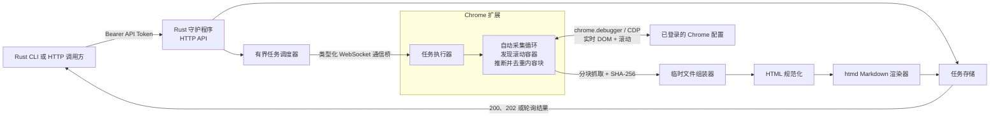
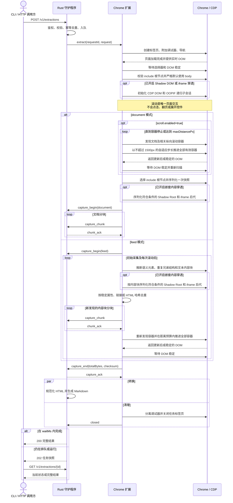
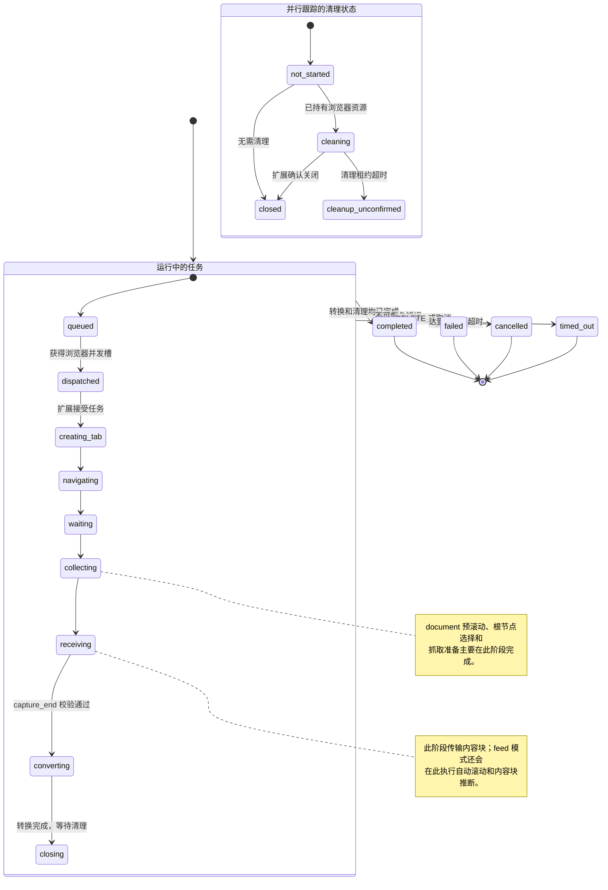
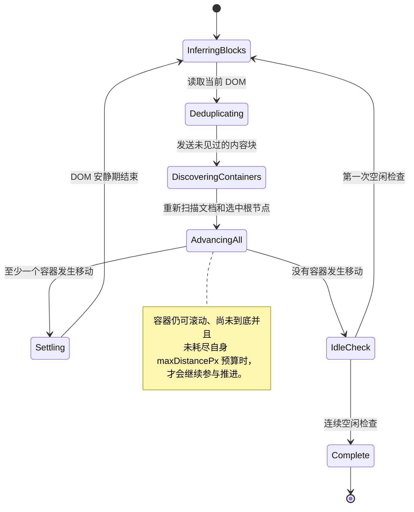
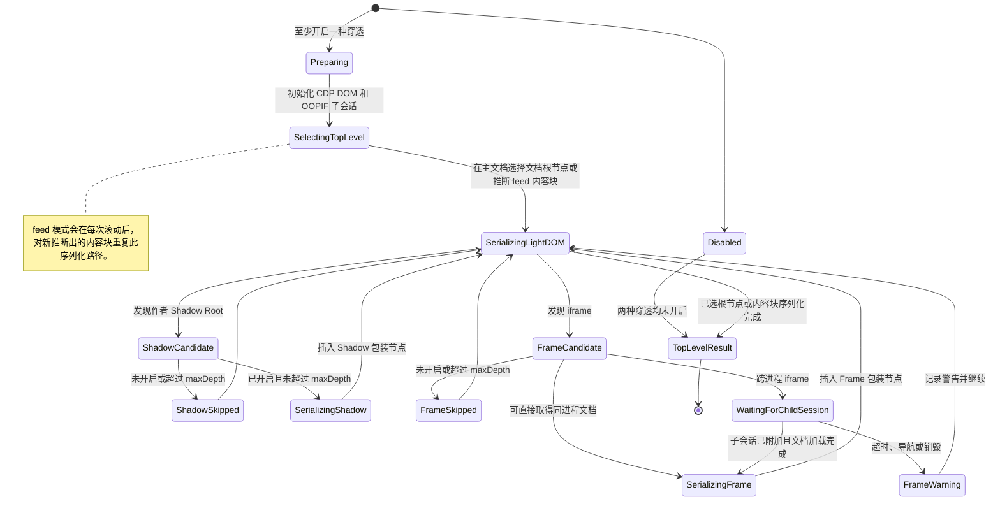

[English](README.md) | 简体中文

# Browser Extractor

## 特性

- **真实浏览器抓取**
  - 基于已登录的 Chrome 或 Chromium、CDP 扩展和 Rust 服务端，无需 Playwright 等浏览器自动化框架。
  - Cookie、凭据和登录状态始终保留在部署主机的浏览器中。
- **本地或远程部署**
  - 可作为本地服务运行，也可通过妥善保护的反向代理对外提供 API。
- **实时 DOM 控制**
  - 支持顶层元素选择与排除、滚动、Shadow Root 穿透，以及同源或跨域 iframe 穿透。
- **三步完成部署**
  - 加载并配置扩展，配置并启动服务端，随后即可请求 HTTP API。
  - 项目同时提供可选的 CLI 客户端。
- **轻量 Rust 程序**
  - 服务端和 CLI 的可执行程序本体均小于 10 MB。
  - CLI 默认输出带 YAML Front Matter 的 Markdown；完整用法请查看 `scrape --help`。

## 下载

每个压缩包都有对应的 SHA-256 文件，Release 还会发布汇总的 [SHA256SUMS](https://github.com/Joey-Kot/Browser-Extractor/releases/download/Latest/SHA256SUMS)。

### 浏览器扩展

| 组件 | 下载 | SHA-256 |
|---|---|---|
| Chrome/Chromium 扩展 | [Browser Extractor](https://github.com/Joey-Kot/Browser-Extractor/releases/download/Latest/browser-extractor-extension.zip) | [sha256](https://github.com/Joey-Kot/Browser-Extractor/releases/download/Latest/browser-extractor-extension.zip.sha256) |

### 服务端程序

| 平台 | 下载 | SHA-256 |
|---|---|---|
| Linux x86_64 | [linux-x86_64](https://github.com/Joey-Kot/Browser-Extractor/releases/download/Latest/browser-extractor-server-linux-x86_64.tar.gz) | [sha256](https://github.com/Joey-Kot/Browser-Extractor/releases/download/Latest/browser-extractor-server-linux-x86_64.tar.gz.sha256) |
| Linux arm64 | [linux-arm64](https://github.com/Joey-Kot/Browser-Extractor/releases/download/Latest/browser-extractor-server-linux-arm64.tar.gz) | [sha256](https://github.com/Joey-Kot/Browser-Extractor/releases/download/Latest/browser-extractor-server-linux-arm64.tar.gz.sha256) |
| Windows x86_64 | [windows-x86_64](https://github.com/Joey-Kot/Browser-Extractor/releases/download/Latest/browser-extractor-server-windows-x86_64.zip) | [sha256](https://github.com/Joey-Kot/Browser-Extractor/releases/download/Latest/browser-extractor-server-windows-x86_64.zip.sha256) |
| Windows arm64 | [windows-arm64](https://github.com/Joey-Kot/Browser-Extractor/releases/download/Latest/browser-extractor-server-windows-arm64.zip) | [sha256](https://github.com/Joey-Kot/Browser-Extractor/releases/download/Latest/browser-extractor-server-windows-arm64.zip.sha256) |
| macOS x86_64 | [macos-x86_64](https://github.com/Joey-Kot/Browser-Extractor/releases/download/Latest/browser-extractor-server-macos-x86_64.zip) | [sha256](https://github.com/Joey-Kot/Browser-Extractor/releases/download/Latest/browser-extractor-server-macos-x86_64.zip.sha256) |
| macOS arm64 | [macos-arm64](https://github.com/Joey-Kot/Browser-Extractor/releases/download/Latest/browser-extractor-server-macos-arm64.zip) | [sha256](https://github.com/Joey-Kot/Browser-Extractor/releases/download/Latest/browser-extractor-server-macos-arm64.zip.sha256) |

### CLI 程序

| 平台 | 下载 | SHA-256 |
|---|---|---|
| Linux x86_64 | [linux-x86_64](https://github.com/Joey-Kot/Browser-Extractor/releases/download/Latest/browser-extractor-cli-linux-x86_64.tar.gz) | [sha256](https://github.com/Joey-Kot/Browser-Extractor/releases/download/Latest/browser-extractor-cli-linux-x86_64.tar.gz.sha256) |
| Linux arm64 | [linux-arm64](https://github.com/Joey-Kot/Browser-Extractor/releases/download/Latest/browser-extractor-cli-linux-arm64.tar.gz) | [sha256](https://github.com/Joey-Kot/Browser-Extractor/releases/download/Latest/browser-extractor-cli-linux-arm64.tar.gz.sha256) |
| Windows x86_64 | [windows-x86_64](https://github.com/Joey-Kot/Browser-Extractor/releases/download/Latest/browser-extractor-cli-windows-x86_64.zip) | [sha256](https://github.com/Joey-Kot/Browser-Extractor/releases/download/Latest/browser-extractor-cli-windows-x86_64.zip.sha256) |
| Windows arm64 | [windows-arm64](https://github.com/Joey-Kot/Browser-Extractor/releases/download/Latest/browser-extractor-cli-windows-arm64.zip) | [sha256](https://github.com/Joey-Kot/Browser-Extractor/releases/download/Latest/browser-extractor-cli-windows-arm64.zip.sha256) |
| macOS x86_64 | [macos-x86_64](https://github.com/Joey-Kot/Browser-Extractor/releases/download/Latest/browser-extractor-cli-macos-x86_64.zip) | [sha256](https://github.com/Joey-Kot/Browser-Extractor/releases/download/Latest/browser-extractor-cli-macos-x86_64.zip.sha256) |
| macOS arm64 | [macos-arm64](https://github.com/Joey-Kot/Browser-Extractor/releases/download/Latest/browser-extractor-cli-macos-arm64.zip) | [sha256](https://github.com/Joey-Kot/Browser-Extractor/releases/download/Latest/browser-extractor-cli-macos-arm64.zip.sha256) |

## 架构图



API 调用方只连接守护程序。扩展只接受定义好的提取任务，不提供任意 CDP 代理。守护程序同一时间只允许一个扩展实例连接。

## 请求时序图



`waitMs` 只控制首次 HTTP 请求等待多久，不会修改任务的硬超时。收到 `202 Accepted` 后任务仍会继续执行，可以通过任务 ID 轮询。

## 任务状态机图



任务只有在进入终态，并且清理状态为 `closed` 或 `cleanup_unconfirmed` 后，才算对 API 完成。即使 WebSocket 断开或扩展没有发送 `closed`，清理租约也会在超时后释放浏览器并发槽。

### feed 自动滚动状态机图

滚动循环不再提供调用方可配置的轮数。每个自动发现的容器分别持有自己的 `maxDistancePx` 预算，任务硬超时仍是全局保护条件。



document 模式开启滚动后会复用其中的容器发现、推进、稳定等待和空闲检查部分，完成后只生成一次最终根节点快照，不累计内容块。

### Shadow Root 和 iframe 穿透状态机图

穿透过程位于现有任务的 `collecting` 或 `receiving` 阶段：document 根节点会在文档分块传输前完成序列化，feed 内容块则在流式传输期间增量序列化。它不会新增对外可见的任务状态。



## 当前功能与限制

- 带身份验证的创建、查询、取消和通信桥状态 API。
- 文档抓取和自动多滚动容器 feed 抓取。
- CSS 选择器始终只在页面主文档的实时 DOM 上执行。
- 可选的作者 Shadow Root、同源 iframe 和跨域 iframe 穿透，并分别限制最大深度。
- UTF-8 安全分块、确认窗口、字节限制和 SHA-256 校验。
- 独立的浏览器并发和转换并发限制。
- 使用临时文件组装抓取内容，并在 Rust 中生成 Markdown。
- 扩展重连、会话状态同步和孤儿标签页清理。

穿透功能默认关闭。用户选择器、页面就绪等待、DOM 稳定等待和滚动都不会进入 Shadow Root 或 iframe 文档。`visibilityMode: "auto"` 当前与 `background` 行为相同。两种抓取模式的 `includeSelectors` 都默认使用 `body`；显式选择器具有最终决定权，未匹配时不会回退到 `body`。

## 环境要求

运行时：

- Chrome 或 Chromium 125 及以上版本。跨域 OOPIF 抓取使用了 Chrome 125 开始提供的 flat debugger 子会话。
- 与当前操作系统、CPU 架构对应的守护程序可执行文件。
- 已构建的扩展 ZIP，或者 `extension/dist/` 目录。
- CLI 可执行文件是可选组件，也可以继续直接调用 HTTP API。

开发时：

- Rust 1.99.1 及以上版本。
- Node.js 24.22.1（与 GitHub Actions 一致）。

Node.js 只用于开发和构建扩展，守护程序和 CLI 运行时都不需要 Node.js。

当前版本使用通信桥协议版本 4。守护程序和扩展需要一起更新；旧协议会被明确拒绝，避免旧扩展继续使用条目选择器和单滚动容器语义后静默返回不完整结果。

## 从源码构建

测试 Rust workspace，然后构建两个可执行文件：

```bash
cargo test --workspace --locked
cargo build --release --locked --bin extractor-server --bin scrape
```

服务端输出为 `target/release/extractor-server`，CLI 输出为 `target/release/scrape`，Windows 下带 `.exe` 后缀。

构建和测试扩展：

```bash
cd extension
npm ci
npm run generate
npm run typecheck
npm test
npm run build
cd ..
```

Chrome 开发模式应加载生成后的 `extension/dist/` 目录。

## 命令行客户端

`scrape` 是只负责网页抓取的单一命令，不包含子命令。它会提交一次抓取请求，在收到 `202 Accepted` 后自动轮询到任务终态，并把完成后的 Markdown 写入新的本地文件。使用前需要确保守护程序已经运行，扩展也已连接。

### CLI 环境变量

CLI 只通过环境变量读取服务配置，不提供 API 地址或密钥命令行参数。

| 环境变量 | 是否必填 | 作用 |
|---|---|---|
| `EXTRACTOR_BASE_URL` | 否 | Browser Extractor 服务端 HTTP 地址，默认 `http://127.0.0.1:17320`。 |
| `EXTRACTOR_API_KEY` | 是 | 通过 `Authorization: Bearer <key>` 发送，值必须与守护程序的 `server.api_token` 或 `EXTRACTOR_API_TOKEN` 相同。 |

Linux 和 macOS：

```bash
export EXTRACTOR_BASE_URL="http://127.0.0.1:17320"
export EXTRACTOR_API_KEY="your-api-token"
```

PowerShell：

```powershell
$env:EXTRACTOR_BASE_URL = "http://127.0.0.1:17320"
$env:EXTRACTOR_API_KEY = "your-api-token"
```

Windows 命令提示符：

```batch
set "EXTRACTOR_BASE_URL=http://127.0.0.1:17320"
set "EXTRACTOR_API_KEY=your-api-token"
```

CLI 会在发送请求和创建输出文件之前校验 `EXTRACTOR_API_KEY`。`scrape --help` 的末尾也会列出这两个环境变量和最小调用示例。

### CLI 基本请求

CLI 默认使用 feed 模式。即使没有指定滚动参数，也会自动发现文档及选中范围内的纵向滚动容器，逐步滚动、收集当前内容块并拼接去重：

```bash
scrape \
  --url https://example.com/feed \
  --output example-feed \
  --path ./Temp-Scrape
```

document 模式用于生成一次文档快照。如果没有提供 `--scroll-px`，document 模式不会滚动：

```bash
scrape \
  --mode document \
  --url https://example.com/article \
  --include-tag 'article' \
  --output article
```

### CLI 参数

| 参数 | 必填/默认值 | 作用 |
|---|---|---|
| `--url <URL>` | 必填 | 目标 HTTP 或 HTTPS URL。 |
| `--output <NAME>` | 必填 | 输出文件名；未带 `.md` 时自动补充。目录部分会被丢弃，应使用 `--path` 指定目录。 |
| `--path <PATH>` | `.` | 输出目录，支持相对路径和绝对路径；抓取成功后如有需要会自动创建。 |
| `--mode <feed\|document>` | `feed` | 抓取模式。feed 模式始终开启滚动。 |
| `--include-tag <SELECTOR>` | 可重复，默认为空 | 顶层包含选择器。省略或清理后为空时，由服务端使用 `body`。 |
| `--exclude-tag <SELECTOR>` | 可重复，默认为空 | 追加到内置排除列表，然后稳定去重。 |
| `--empty-tags` | 关闭 | 无条件清空内置排除列表，但保留 `--exclude-tag`。 |
| `--scroll-px <PIXELS>` | 服务端默认最大 60000 | 设置每个自动发现的滚动容器允许滚动的最大累计距离，必须大于 0，并自动开启滚动。 |
| `--timeout <SECONDS>` | `120` | CLI 到守护程序的每次 HTTP 请求超时，单位为秒。 |
| `--scrape-timeout <SECONDS>` | 服务端默认值 | 服务端任务硬超时。CLI 会把秒转换成 `jobTimeoutMs`。 |
| `--wait-load <SECONDS>` | 服务端默认 `1` | 采集前等待 DOM 连续保持稳定的时间，单位为秒。CLI 转换为 `settleMs`；`0` 表示跳过这次等待。 |
| `--shadow-dom <DEPTH>` | 关闭 | 开启 Shadow DOM 穿透，并将正整数设为 `maxDepth`。 |
| `--iframes <DEPTH>` | 关闭 | 开启同源和跨域 iframe 穿透，并将正整数设为 `maxDepth`。 |
| `--verify-ssl` | 关闭 | 校验 HTTPS `EXTRACTOR_BASE_URL` 的证书和主机名。默认接受本地或自签名守护程序证书，不影响目标网页的 TLS。 |
| `--help` | — | 输出用法、参数、环境变量和示例。 |

`--include-tag` 和 `--exclude-tag` 都可以重复。每次出现只接收一个完整 CSS 选择器；CLI 只清理首尾空白并稳定去重，不再按逗号拆分，也不再解析 JSON 数组：

```bash
scrape \
  --url https://example.com \
  --output example \
  --include-tag 'article' \
  --include-tag '.article' \
  --exclude-tag '.content' \
  --exclude-tag '.ad'
```

复数参数名 `--include-tags` 和 `--exclude-tags` 保留为兼容别名，也遵循“每次一个完整选择器”的新语义。逗号现在属于 CSS 选择器本身，例如 `--include-tag 'article:has(h1, h2)'` 会完整传递；如需多个独立选择器，应重复参数。旧的 JSON 数组形式不再作为选择器列表解析。

#### Bash 和 PowerShell 转义

Bash 与 PowerShell 都建议使用单引号包住每个完整选择器。这样可以保护 `#`、`*`、`$`、`[`、`]` 等 shell 特殊字符，同时保留属性值外层的 CSS 双引号。

Bash：

```bash
scrape \
  --url https://example.com \
  --output selectors \
  --include-tag 'xxx' \
  --include-tag '.xxx' \
  --include-tag '#xxx' \
  --include-tag 'xxx[xxx*="xxx"]' \
  --include-tag '[xxx*="xxx"]' \
  --include-tag '[xxx^="xxx"]' \
  --include-tag '[xxx$="xxx"]'
```

PowerShell：

```powershell
scrape `
  --url https://example.com `
  --output selectors `
  --include-tag 'xxx' `
  --include-tag '.xxx' `
  --include-tag '#xxx' `
  --include-tag 'xxx[xxx*="xxx"]' `
  --include-tag '[xxx*="xxx"]' `
  --include-tag '[xxx^="xxx"]' `
  --include-tag '[xxx$="xxx"]'
```

这些形式都受支持：`xxx` 是类型选择器，`.xxx` 是类选择器，`#xxx` 是 ID 选择器，`*=`、`^=`、`$=` 分别表示属性值包含、前缀和后缀匹配。CLI 不限制其他标准 CSS 语法；最终由 Chrome 的 `querySelectorAll` 校验，无效语法返回 `selector_invalid`。

### 选择器优先级和内置排除列表

选择器优先级为：

```text
--include-tag > --exclude-tag > 内置 exclude
```

完成首尾空白清理和稳定去重后，CLI 按以下规则计算：

```text
B = --empty-tags ? [] : 内置 exclude
I = 所有 --include-tag 值
E = 所有 --exclude-tag 值

includeSelectors = I；I 为空时省略，由服务端使用 ["body"]
excludeSelectors = stableUnique(B + E) - I
```

减法只按清理后的选择器字符串精确比较，不尝试分析不同 CSS 选择器是否等价。同一个选择器同时出现在显式排除和内置排除中时只保留一次；如果它还出现在包含列表中，则由包含列表覆盖，并从最终排除列表中删除。

| 指定的参数 | 最终包含列表 | 最终排除列表 |
|---|---|---|
| 全部省略 | 服务端默认 `["body"]` | 内置列表 |
| include | include | 内置列表 |
| exclude | 服务端默认 `["body"]` | 内置列表 + exclude |
| empty | 服务端默认 `["body"]` | 空 |
| include + exclude | include | 内置列表 + exclude，再减去 include |
| include + empty | include | 空 |
| exclude + empty | 服务端默认 `["body"]` | exclude |
| include + exclude + empty | include | exclude，再减去 include |

内置排除列表完整复制自参考 CLI，当前内容为：

```text
script, style, noscript, form, input, button, select, textarea,
nav, .nav, .navbar, .navigation, .menu, .menubar, header, footer, aside,
[class*="logo"], [class*="brand"], [id*="logo"], img[alt*="logo"],
img[src*="logo"], [id*="brand"], [class^="category--"], [id^="category--"],
[class$="--category"], [id$="--category"], [class^="skip"],
[class*="accessib"], .sr-only, .visually-hidden, [class*="-ad-"],
[class*="_ad_"], [class$="-ad"], [class$="_ad"], [class^="ad-"],
[class^="ad_"], [class*="advert"], .sidebar, #sidebar, [class*="sidebar"],
[class*="sider"], [class^="menu-"], [class^="menu_"], [class$="_module"],
[class$="-module"], [class*="breadcrumb"], [class*="pagination"],
[class*="relate"], [class*="recommend"], [class*="trending"],
[class^="header-"], [class$="-header"], [class^="header_"],
[class$="_header"], [class*="footer"], [class$="-offset"],
[class*="-offset-"], [class$="_offset"], [class*="_offset_"]
```

### 滚动和穿透

服务端要求 feed 任务必须设置 `scroll.enabled=true`，因此即使没有提供 `--scroll-px`，CLI 的默认 feed 模式也会自动开启滚动。`--scroll-px` 现在表示每个自动发现的滚动容器的最大累计滚动距离，而不是单轮步长；省略时使用服务端默认值 60000 像素。扩展按容器可视高度自动计算步长，保留约 20% 重叠，并以 1500 像素为上限。

document 模式未提供 `--scroll-px` 时会省略滚动配置；提供后会发送 `scroll.enabled=true` 和 `scroll.maxDistancePx`。

两个穿透参数分别开启对应目标，例如：

```bash
scrape \
  --url https://example.com \
  --output nested-content \
  --shadow-dom 4 \
  --iframes 2
```

该请求会设置 `traversal.shadowDom.enabled=true`、`maxDepth=4`，以及 `traversal.iframes.enabled=true`、`maxDepth=2`。选择器和滚动仍然只在顶层文档执行，穿透只会在完成顶层选择后序列化符合条件的嵌套内容。

### CLI 输出和退出行为

CLI 不会覆盖已有文件。只有 API 成功后才会创建目标目录，并在同一目录写入临时文件，最后以禁止覆盖的方式发布为目标文件。因此 API、轮询、转换或写入失败都不会截断已有结果。

每个完成的 `.md` 文件都以 YAML Front Matter 开头。`name` 使用页面标题，`url` 使用导航后的 `finalUrl`，两个值都会安全加引号：

```markdown
---
name: "示例标题"
url: "https://example.com/final"
---

# 转换后的 Markdown 正文
```

为了方便 shell Agent 使用，标准输出保持紧凑。成功时只输出：

```text
true
```

失败时输出：

```text
false
<具体错误原因>
```

成功退出码为 `0`；参数无效或缺少 CLI 配置时使用退出码 `2`；网络、API、抓取、轮询和文件错误使用退出码 `1`。

## 配置守护程序

守护程序不会自动搜索配置文件。先复制示例文件，再通过参数明确指定：

```bash
cp config.example.toml extractor.toml
./target/release/extractor-server --config extractor.toml
```

通过 Cargo 运行时：

```bash
cargo run --release --bin extractor-server -- --config extractor.toml
```

完整配置如下：

```toml
[server]
listen = "127.0.0.1:17320"
api_token = "替换为足够长的随机-API-Token"
allow_cors = true

[bridge]
listen = "127.0.0.1:17321"
extension_token = "替换为另一个不同的扩展-Token"
browser_instance_id = ""
ping_interval_seconds = 20

[executor]
max_concurrency = 10
max_conversion_concurrency = 4
max_queue_size = 1000
job_timeout_ms = 120000
cleanup_timeout_ms = 10000

[capture]
chunk_bytes = 262144
max_result_bytes = 33554432
max_total_inflight_bytes = 268435456
max_unacked_chunks = 8

[jobs]
result_ttl_seconds = 600
max_completed_jobs = 1000

[conversion]
renderer = "htmd"
```

`server.api_token` 和 `bridge.extension_token` 应使用不同的值。如果其中任何一个为空，守护程序会在启动时生成一个随机的 48 字符 Token 并写入日志。这个临时 Token 会在下次启动时改变，正常使用时应明确配置固定 Token。

### 守护程序配置项

| 配置项 | 默认值 | 作用 |
|---|---:|---|
| `server.listen` | `127.0.0.1:17320` | HTTP API 监听地址。 |
| `server.api_token` | 空 | 所有 `/v1/*` 接口使用的 Bearer Token。留空时生成临时 Token。 |
| `server.allow_cors` | `true` | 允许浏览器跨域访问 HTTP API。开启后接受任意来源，以及 API 使用的 GET、POST、DELETE、Authorization、Content-Type 和 Idempotency-Key；`/v1/*` 仍然必须鉴权。 |
| `bridge.listen` | `127.0.0.1:17321` | WebSocket 通信桥监听地址。扩展地址还需要加上 `/bridge` 路径。 |
| `bridge.extension_token` | 空 | 扩展在第一条 WebSocket 消息中发送的 Token，应使用与 API Token 不同的值。 |
| `bridge.browser_instance_id` | 空 | 可选的浏览器配置锁。留空时接受任意一个扩展；填写后只接受扩展弹窗中显示的同名实例 ID。 |
| `bridge.ping_interval_seconds` | `20` | 通信桥心跳间隔。小于 5 秒的值实际会提升到 5 秒。 |
| `executor.max_concurrency` | `10` | 同时持有标签页和调试器会话的浏览器任务上限。 |
| `executor.max_conversion_concurrency` | `4` | 同时执行的阻塞式 HTML 转 Markdown 任务上限。 |
| `executor.max_queue_size` | `1000` | 最大排队任务数，超过后返回 `queue_full`。 |
| `executor.job_timeout_ms` | `120000` | 服务端允许的任务最大硬超时。请求中的 `jobTimeoutMs` 不能超过它。 |
| `executor.cleanup_timeout_ms` | `10000` | 等待标签页和调试器清理的时间，超时后以 `cleanup_unconfirmed` 释放并发槽。 |
| `capture.chunk_bytes` | `262144` | 单个抓取分块的最大 UTF-8 字节数，默认 256 KiB。 |
| `capture.max_result_bytes` | `33554432` | 单个任务允许抓取的最大 HTML，默认 32 MiB。 |
| `capture.max_total_inflight_bytes` | `268435456` | 所有并发抓取的全局内存/磁盘压力额度，默认 256 MiB。 |
| `capture.max_unacked_chunks` | `8` | 扩展在未收到确认时最多可以继续发送的分块数。 |
| `jobs.result_ttl_seconds` | `600` | 完成结果及其幂等键映射的保留时间。 |
| `jobs.max_completed_jobs` | `1000` | 最多保留的已完成任务数，超过后优先删除最早的结果。 |
| `conversion.renderer` | `htmd` | 预留选择项，当前只支持 `htmd`。 |

程序先读取配置文件，再由受支持的命令行参数覆盖：

```bash
extractor-server \
  --config extractor.toml \
  --listen 127.0.0.1:17320 \
  --bridge-listen 127.0.0.1:17321 \
  --max-concurrency 10 \
  --max-conversion-concurrency 4
```

两个 Token 也可以通过环境变量传入：

```bash
EXTRACTOR_API_TOKEN="api-token" \
EXTRACTOR_EXTENSION_TOKEN="extension-token" \
extractor-server --config extractor.toml
```

对应的命令行参数为 `--api-token` 和 `--extension-token`。

除非外部已经提供可信的网络隔离，否则应让两个监听地址保持在本机回环地址。守护程序本身不提供 TLS。

## 配置 Chrome 扩展

先完成扩展构建或解压扩展 ZIP。所选目录的根目录必须直接包含 `manifest.json`。

1. 打开 `chrome://extensions`。
2. 开启右上角的**开发者模式**。
3. 点击**加载已解压的扩展程序**。
4. 选择 `extension/dist/`，或者解压 `browser-extractor-extension.zip` 后得到的目录。
5. 打开 Browser Extractor 工具栏弹窗。
6. 如果没有修改 `bridge.listen`，将弹窗中的 **Bridge 地址**填写为 `ws://127.0.0.1:17321/bridge`。
7. 将**扩展 Token**填写为 `bridge.extension_token` 的准确值。这里不能填写 API Token。
8. 点击**保存并重连**，等待弹窗显示**已连接**。

扩展弹窗还会显示自动生成的浏览器实例 ID。如果需要把守护程序锁定到当前 Chrome 配置，可以把这个值复制到 `bridge.browser_instance_id`，然后重启守护程序。

通过需要鉴权的 API 检查连接状态：

```bash
curl -sS http://127.0.0.1:17320/v1/bridge/status \
  -H 'Authorization: Bearer YOUR_API_TOKEN'
```

## HTTP API

所有 `/v1/*` 接口都必须带上：

```http
Authorization: Bearer YOUR_API_TOKEN
```

`GET /health` 是公开的存活检查接口。

| 方法和路径 | 作用 |
|---|---|
| `POST /v1/extractions` | 创建提取任务，或者返回 `Idempotency-Key` 对应的已有任务。 |
| `GET /v1/extractions/{id}` | 查询当前状态或仍在保留期内的结果。 |
| `DELETE /v1/extractions/{id}` | 取消排队中或运行中的任务，并返回最新快照。 |
| `GET /v1/bridge/status` | 查看扩展连接、队列深度、浏览器并发槽和传输中字节数。 |

JSON 中出现未知字段会返回 HTTP 400。

### 通用请求参数

| 字段 | 默认值 | 作用 |
|---|---:|---|
| `url` | 必填 | 目标 HTTP 或 HTTPS URL，其他协议会被拒绝。 |
| `mode` | `document` | `document` 一次抓取选中的根节点；`feed` 自动滚动并持续收集、拼接和去重内容块。 |
| `waitMs` | `30000` | POST 请求等待任务完成的时间。设为 `0` 会立即返回任务快照，同时任务继续执行。该值受两个硬超时共同限制。 |
| `jobTimeoutMs` | `120000` | 整个任务请求的硬超时，最大不能超过 `executor.job_timeout_ms`，且必须大于 0。 |
| `loadTimeoutMs` | `30000` | 分别用于页面导航、`waitForSelector` 和每次嵌套内容抓取的超时，必须大于 0。 |
| `settleMs` | `1000` | 页面就绪后、正式抓取前要求 DOM 保持安静的时间。 |
| `visibilityMode` | `background` | 可选 `background`、`foreground`、`auto`。`auto` 当前等同于 `background`。 |
| `waitForSelector` | `null` | 可选的页面就绪 CSS 选择器，只负责等待，不会限制最终提取范围。 |
| `includeSelectors` | `["body"]` | 两种模式下都表示提取根节点；feed 模式还会用它限制内容块推断和内部滚动容器发现范围。省略或传空数组时统一变为 `["body"]`；显式选择器必须命中，不会回退到 `body`。 |
| `excludeSelectors` | `[]` | 从克隆结果中删除的子树。选择节点时还会固定删除 `script`、`style`、`noscript`、`template`。 |
| `traversal` | 关闭 | Shadow DOM 和 iframe 序列化配置，必须显式开启对应目标。 |
| `scroll` | 见下文 | 自动滚动和内容块去重配置。 |
| `output` | `{"includeHtml":false}` | 响应输出配置，目前只有 `includeHtml` 一个参数。 |

所有用户提供的选择器都通过主文档中的 `querySelectorAll` 执行。即使开启穿透，选择器也不会进入 Shadow Root 或 iframe。CSS 语法错误返回 `selector_invalid`；页面完成就绪和稳定等待后，如果没有任何 `includeSelectors` 命中，两种模式都返回 `selector_not_found`，扩展不会替换成 `body`。扩展先在顶层页面确定文档根节点或自动推断出的内容块，再只对这些节点的后代执行递归序列化。

`excludeSelectors` 始终应用于已选根节点的克隆，包括默认的 `body`。多个 include 选择器按 DOM 顺序合并，并删除重复节点以及已经被已选祖先覆盖的后代节点。

### Shadow DOM 和 iframe 穿透

两类穿透都需要显式开启，并且可以独立配置：

```json
{
  "traversal": {
    "shadowDom": {
      "enabled": true,
      "maxDepth": 3
    },
    "iframes": {
      "enabled": true,
      "maxDepth": 3
    }
  }
}
```

| 字段 | 默认值 | 作用 |
|---|---:|---|
| `traversal.shadowDom.enabled` | `false` | 序列化顶层已选节点下的 open 和 closed 作者 Shadow Root，忽略浏览器自身的 `user-agent` Shadow Root。 |
| `traversal.shadowDom.maxDepth` | `3` | 最大 Shadow Root 嵌套深度。直接位于主文档下的 Shadow Root 深度为 1。 |
| `traversal.iframes.enabled` | `false` | 序列化顶层已选节点下的同源和跨域 iframe 文档。 |
| `traversal.iframes.maxDepth` | `3` | 最大 iframe 嵌套深度。直接位于主文档下的 iframe 深度为 1。 |

Shadow Root 深度和 iframe 深度分别计算，不单独限制根节点或 Frame 数量。任务硬超时、深度配置和 `capture.max_result_bytes` 仍然是最终限制。iframe 不会自动滚动，也不参与 `waitForSelector` 或 DOM 稳定等待。

Shadow 内容会在宿主节点内部使用可见的合成元素表示，保证后续 Markdown 转换不会丢失内容：

```html
<section data-extractor-shadow-root="open" data-extractor-shadow-depth="1">
  ...
</section>
```

Frame 的 `body` 内容会插入到对应 iframe 元素之后：

```html
<section
  data-extractor-frame-url="https://frame.example/page"
  data-extractor-frame-origin="https://frame.example"
  data-extractor-frame-depth="1"
>
  ...
</section>
```

合并文档前，扩展会按照内容所属文档的 base URL，把相对的 `href`、`src`、`poster`、`action` 和 `formaction` 转成绝对地址，空引用和仅含片段的引用也会正确处理。某个 Frame 在抓取时发生导航、销毁、超时或无法附加调试器时，会跳过该 Frame，不会让整个任务失败；完成结果会通过 `warnings` 说明被跳过的内容。子会话会等待 Frame 文档达到 `readyState=complete`，每个 Frame 的抓取时间同时受 `loadTimeoutMs` 和任务剩余期限限制。

开启穿透后，已选节点会改用 CDP 重建序列化，因此空白和属性引号等细节可能与原生 `outerHTML` 略有不同。扩展会先只抓取 light DOM，再逐层按需抓取符合限制的 Shadow Root、同进程 Frame 或跨进程 Frame；关闭的穿透类型和超过 `maxDepth` 的后代不会被预先穿透或下载。feed 模式下，`html_hash` 以及其他策略的哈希回退会包含插入后的嵌套内容。

## document 模式示例

下面的请求会等待文章节点出现，提取最外层的 `article`，删除不需要的子树，并只返回 Markdown：

```bash
curl -sS -X POST http://127.0.0.1:17320/v1/extractions \
  -H 'Authorization: Bearer YOUR_API_TOKEN' \
  -H 'Content-Type: application/json' \
  -H 'Idempotency-Key: article-example-2026-01' \
  -d '{
    "url": "https://example.com/article",
    "mode": "document",
    "waitMs": 30000,
    "jobTimeoutMs": 120000,
    "loadTimeoutMs": 30000,
    "settleMs": 1000,
    "visibilityMode": "background",
    "waitForSelector": "article",
    "includeSelectors": ["article"],
    "excludeSelectors": ["aside", ".advertisement", ".cookie-banner"],
    "traversal": {
      "shadowDom": {
        "enabled": true,
        "maxDepth": 3
      },
      "iframes": {
        "enabled": true,
        "maxDepth": 2
      }
    },
    "output": {
      "includeHtml": false
    }
  }'
```

省略 `includeSelectors` 或传入空数组时，document 模式会抓取清理后的 `body` 内容。守护程序不会隐式发现正文；需要缩小范围时应明确传入 `article`、`main` 等选择器。选择器没有命中时返回 `selector_not_found`。

## feed 模式示例

feed 模式只要求明确填写 `scroll.enabled=true`，其他滚动参数都可以省略。最小配置如下：

```json
{
  "scroll": {
    "enabled": true
  }
}
```

省略的字段会使用 `includeSelectors=["body"]`、`maxDistancePx=60000`、`settleMs=700` 和 `dedupe={}`（即 `auto` 策略）。扩展会自动发现文档滚动元素以及选中范围内尺寸足够、可见且存在纵向溢出的内部容器；每轮滚动前收集当前 DOM 中的语义元素、重复兄弟结构和文本内容块。虚拟列表移除旧节点前，这些内容已经被发送并保留，因此不会再退化为最终 `body` 快照。下面的完整示例把每个滚动容器的预算限制为 30000 像素，并使用 `data-post-id` 优先去重：

```bash
curl -sS -X POST http://127.0.0.1:17320/v1/extractions \
  -H 'Authorization: Bearer YOUR_API_TOKEN' \
  -H 'Content-Type: application/json' \
  -H 'Idempotency-Key: feed-example-run-001' \
  -d '{
    "url": "https://example.com/feed",
    "mode": "feed",
    "waitMs": 30000,
    "jobTimeoutMs": 120000,
    "loadTimeoutMs": 30000,
    "settleMs": 1000,
    "visibilityMode": "background",
    "waitForSelector": ".feed-card",
    "includeSelectors": ["main"],
    "excludeSelectors": [".sponsored", ".share-toolbar"],
    "scroll": {
      "enabled": true,
      "maxDistancePx": 30000,
      "settleMs": 700,
      "dedupe": {
        "strategy": "attribute",
        "attribute": "data-post-id"
      }
    },
    "output": {
      "includeHtml": true
    }
  }'
```

扩展会同时推进当前发现的所有有效纵向滚动容器，并在 DOM 变化后重新扫描新出现的容器。每个容器达到 `maxDistancePx`、抵达底部，或者连续内部检查都无法继续移动时停止；整个任务仍受 `jobTimeoutMs` 限制。项目不会点击“加载更多”、切换分页、展开折叠区或执行其他页面交互。

### 滚动参数

| 字段 | 默认值 | 作用 |
|---|---:|---|
| `enabled` | 必填 | 只要提供 `scroll` 对象就必须填写；feed 模式下必须为 `true`。 |
| `maxDistancePx` | `60000` | 每个自动发现的滚动容器允许移动的最大累计滚动距离，必须大于 0。 |
| `settleMs` | `700` | 每次滚动后等待 DOM 稳定的时间。 |
| `dedupe` | `{}` | 自动推断内容块的去重配置，空对象表示使用 `auto` 策略。 |

### feed 去重策略

| 策略 | 去重键的选择方式 |
|---|---|
| `auto` | 依次尝试 `data-post-id`、`data-item-id`、`data-id`、`data-key`、首选链接，最后使用内容块 HTML 的 SHA-256。 |
| `attribute` | 使用 `dedupe.attribute` 指定的属性值；属性不存在时退回到内容块 HTML 哈希。 |
| `link` | 使用 `dedupe.selector` 选中的链接，未配置时使用第一个 `a[href]`；没有链接时退回到内容块 HTML 哈希。 |
| `html_hash` | 直接使用内容块 HTML 的 SHA-256。 |

`dedupe.attribute` 只对 `attribute` 有意义。`dedupe.selector` 会在每个自动推断的内容块内部执行，主要用于 `link`；它也会作为 `auto` 策略的首选链接来源。

## Idempotency-Key 是什么

`Idempotency-Key` 是可选的请求头，不是身份验证凭据。

- 第一次使用某个键成功发送 POST 时，会创建任务并记录这个键和任务 ID 的关系。
- 再次使用相同的键时，直接返回原任务，不会再打开一个 Chrome 标签页。
- 程序不会比较请求 JSON。即使第二次请求的参数不同，只要键相同，仍会返回第一次的任务。
- 键最长 256 字节。
- 任务结果过期或被淘汰后，对应的键也会删除。

一个逻辑提取任务应使用一个稳定且唯一的键，例如上游系统的任务 ID。如果每次 POST 都应该创建新任务，就不要发送这个请求头。不要让互不相关的 URL 共用一个固定键。

## output 参数

`output` 目前只有一个参数：

| 字段 | 默认值 | 作用 |
|---|---:|---|
| `includeHtml` | `false` | 为 false 时，成功结果包含 Markdown 并省略 `html`；为 true 时，还会返回抓取 HTML。HTML/XHTML 内容会先规范化，纯文本和 JSON 则保留抓取时的表示形式。开启后会增加结果存储和 HTTP 响应大小。 |

所有成功且内容类型受支持的任务都会生成 Markdown。`includeHtml` 不会关闭 Markdown，也不会绕过 `capture.max_result_bytes` 限制。

## 响应、轮询和取消

完整结果示例：

```json
{
  "id": "550e8400-e29b-41d4-a716-446655440000",
  "status": "completed",
  "cleanupStatus": "closed",
  "requestedUrl": "https://example.com/article",
  "finalUrl": "https://example.com/article",
  "title": "示例文章",
  "mimeType": "text/html",
  "markdown": "# 示例文章\n\n提取后的正文。",
  "warnings": [
    {
      "kind": "iframe",
      "message": "Frame debugger session was not attached before timeout",
      "url": "https://frame.example/embed",
      "depth": 1
    }
  ],
  "stats": {
    "elapsedMs": 1842,
    "scrollRounds": 0,
    "matchedItems": 0,
    "htmlBytes": 18420
  }
}
```

没有可恢复的穿透跳过时，响应会省略 `warnings`。警告不会把成功任务改成 `failed`，只表示请求的某一部分嵌套内容没有成功抓取。

`stats.scrollRounds` 表示至少有一个自动发现的容器发生移动的采集轮次；`stats.matchedItems` 在 feed 模式下表示最终发送的去重内容块数量。字段名为保持响应兼容性而保留。

任务在 `waitMs` 内完成时，POST 返回 HTTP 200；否则返回 HTTP 202 和相同结构的任务快照，此时通常还没有最终输出。

轮询任务：

```bash
curl -sS http://127.0.0.1:17320/v1/extractions/JOB_ID \
  -H 'Authorization: Bearer YOUR_API_TOKEN'
```

取消任务：

```bash
curl -sS -X DELETE http://127.0.0.1:17320/v1/extractions/JOB_ID \
  -H 'Authorization: Bearer YOUR_API_TOKEN'
```

完成结果按 `jobs.result_ttl_seconds` 和 `jobs.max_completed_jobs` 保留。结果被删除后，GET 会返回 HTTP 404。

## 安全默认值

- 两个监听地址默认都绑定 `127.0.0.1`。
- API Token 和扩展 Token 相互独立。
- 凭据只放在 HTTP 请求头或第一条 WebSocket 消息中，不会写入通信桥 URL。
- 默认允许本地浏览器客户端跨域访问。不需要跨域访问时可以设置 `server.allow_cors=false`；如果 `server.listen` 不再绑定回环地址，更应谨慎关闭或增加外部网络隔离。
- 目标 URL 只允许 HTTP 和 HTTPS。
- 登录状态始终留在现有 Chrome 用户配置中。
- 扩展通信桥只处理任务协议，不提供通用远程 CDP 代理。

## 仓库结构

| 组件 | 源码位置 | 构建产物 |
|---|---|---|
| Rust 服务端 | `crates/extractor-daemon/src/` | `target/release/extractor-server` |
| Rust CLI | `crates/extractor-cli/src/` | `target/release/scrape` |
| Chrome 扩展 | `extension/src/` | `extension/dist/` |
| HTTP API 定义 | `spec/openapi.yaml` | OpenAPI 工具输入 |
| 通信桥协议 | `spec/bridge.schema.json` | `extension/src/generated/protocol.ts` |
| 动态测试页面 | `fixtures/test-site/` | 本地静态测试站点 |
